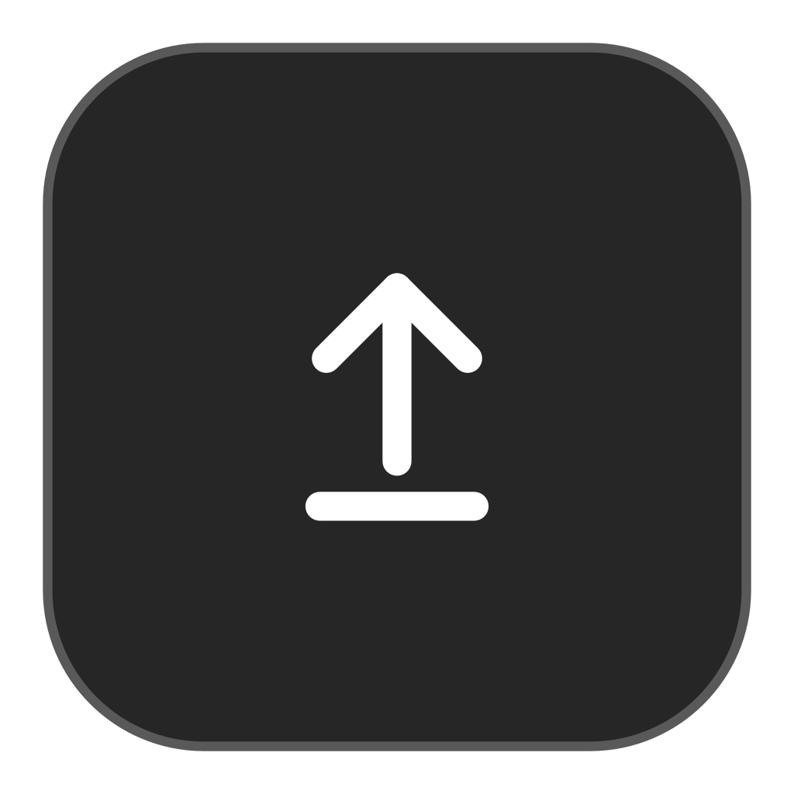

<p align="center">
  
</p>

<h1 align="center">topd</h1>

<p align="center">
  <strong>htop for macOS, without opening a window.</strong><br/>
  Live CPU, memory, GPU, storage, system, and network cards, plus the top processes, from your menu bar.
</p>

<p align="center">
  
  
  
  
</p>

---

topd lives in your menu bar. Click it for a compact popover with six live cards and the processes using the most CPU and memory. Right-click for preferences. It has no Dock icon and no window, and it doesn't send anything anywhere.

## Contents

- [Features](#features)
- [Requirements](#requirements)
- [Install and run](#install-and-run)
- [Using topd](#using-topd)
- [Themes](#themes)
- [Privacy](#privacy)
- [Troubleshooting](#troubleshooting)
- [Community](#community)
- [Development](#development)
- [Contributing](#contributing)
- [License](#license)

## Features

- **Six metric cards**, each with its own chart: CPU (history and per-core bars), Memory (app, wired, compressed, free), GPU (Apple Silicon utilization), Storage (with warnings at 85% and 95% full), System (uptime and load averages), and Network (download and upload history).
- **Process lists.** The top five processes by CPU and by memory, with CPU percent and memory for each. Search by name or PID, and sort by CPU, memory, name, or PID.
- **At a glance.** Turn on *Show values* to replace the menu bar icon with the values of one to three cards you pick. The item sizes itself to the number of cards.
- **Reorderable cards.** Drag a card's handle in Preferences; the popover follows the new order.
- **A popover that fits its content.** One card is one column, two are two, and three or more fill three columns.
- **Twelve themes**, including a translucent default and a System theme that follows macOS light and dark.
- **Launch at login**, from Preferences.
- **Light on the machine.** About 0.1 percent CPU with the popover closed. The menu bar updates every two seconds, and the popover refreshes every second only while it is open.

## Requirements

- macOS 14 (Sonoma) or later
- Xcode Command Line Tools, for the Swift compiler: `xcode-select --install`

topd is built from source on your Mac. There's no installer to download yet.

## Install and run

```sh
git clone https://github.com/sorens-co/topd.git
cd topd
./run.sh
```

`run.sh` builds a release binary, wraps it in `.build/topd.app`, signs it locally, and starts it. The first build takes a few minutes. Look for the topd icon in your menu bar.

**Stop it:** `pkill -x topd`

**Optional alias,** so `topd` starts it from any terminal. Add this to `~/.zshrc`, then run `source ~/.zshrc`:

```sh
alias topd='/absolute/path/to/topd/run.sh'
```

**Update it:** `git pull && pkill -x topd; ./run.sh`

## Using topd

| Action | How |
| --- | --- |
| Open the popover | Left-click the menu bar icon |
| Close it | Click outside the popover, or click the icon again |
| Preferences | Gear button in the popover, or right-click the icon → Preferences |
| Quit | Power button in the popover, or right-click the icon → Quit topd |
| Search processes | Type in the search field (name or PID) |
| Sort processes | Choose CPU, Memory, Name, or PID in the sort control |

### Preferences

- **General.** Launch at login.
- **Customize.** The icon (topd logo, gauge, waveform, chip, or trend), and the theme. With the System theme, choose which dark and light themes to use.
- **At a glance.** Show values in the menu bar, and pick one to three cards to show.
- **Cards.** Turn each card on or off, and drag to reorder. At least one card stays on.
- **Processes.** Show or hide the top-5 CPU list and the top-5 memory list.

### Launch at login

Turn on **General → Launch at login**. topd registers itself with macOS through `SMAppService`, which needs the app bundle that `run.sh` builds. If macOS asks for approval, allow topd in **System Settings → General → Login Items**. The command line equivalent is `.build/topd.app/Contents/MacOS/topd --login-item status|on|off`.

> If you move the repository after turning on launch at login, turn it off, run `./run.sh` from the new location, and turn it on again.

## Themes

| Group | Themes |
| --- | --- |
| Default | **Default** (translucent glass) |
| Follow macOS | **System**, with your choice of dark and light themes |
| Dark | Dracula · Nord · One Dark |
| Light | GitHub Light · Ayu Light · Gruvbox Light |
| Fun | Synthwave · Ember · Slate · Ocean |

Themes change only the app's chrome. The chart colors use one fixed, contrast-checked palette in every theme, so the data reads the same everywhere.

## Privacy

topd reads process and system statistics that macOS exposes to your user account, and draws them on your screen. That's all it does.

- **No network access.** The app makes no network connections and has no telemetry.
- **No accounts, no cloud.**
- **Local preferences only,** stored in your user defaults.
- **No elevated privileges.** Processes that your user can't inspect are skipped.
- **Read-only.** topd doesn't stop, change, or signal any process.

## Troubleshooting

| Problem | What to check |
| --- | --- |
| `./run.sh` says the Swift compiler is missing | Run `xcode-select --install`, then try again. |
| "topd is already running" | It's already in the menu bar. To restart: `pkill -x topd; ./run.sh`. |
| The GPU card says "Not reported on this Mac" | The GPU counter isn't exposed on this machine. The other cards still work. |
| Launch at login says it needs approval | Allow topd in System Settings → General → Login Items. |
| Launch at login stopped working after a move | See the note under [Launch at login](#launch-at-login). |

## Development

```sh
swift build                                # debug build
swift run topd-checks                      # behavior checks; reports "0 failed" when all pass
swift build -c release --product topd      # release build, as used by run.sh
scripts/measure-cpu.sh 30                  # average CPU of the running app over 30 seconds
```

Project layout:

| Path | Contents |
| --- | --- |
| `Sources/TopdCore` | Sampling (CPU, memory, storage, network, GPU, processes), ranking, history, and preference rules. No UI code. |
| `Sources/topd` | The menu bar app: popover, cards, charts, preferences, themes, and the status item. |
| `Checks/` | `topd-checks`, the behavior checks. |
| `Support/` | `Info.plist` and the app icon. |
| `scripts/` | Helper scripts. |
| `docs/` | Product brief. |

`topd-checks` is an executable, not an XCTest target, because the Command Line Tools install doesn't include XCTest or the Swift Testing macros.

## Community

- **[Wiki](https://github.com/sorens-co/topd/wiki):** install guide, preferences, troubleshooting, and architecture notes.
- **[Discussions](https://github.com/sorens-co/topd/discussions):** questions, ideas, and show-and-tell. Use Discussions for questions, and Issues for bugs.

## Contributing

Contributions are welcome. Read [CONTRIBUTING.md](CONTRIBUTING.md) first.

Changes reach `master` through pull requests only. Every pull request is reviewed and approved by the maintainer, and the CI checks must pass before it can be merged. Please open an issue to talk through a larger change before you start it.

Report security problems privately, as described in [SECURITY.md](SECURITY.md).


## Versioning and releases

topd follows [Semantic Versioning](https://semver.org/). Each release is tagged, listed in [CHANGELOG.md](CHANGELOG.md), and published on the repository's Releases page. Watch the repository (Releases only) to hear about new versions. topd doesn't check for updates itself, because that would need a network connection.

## License

topd is released under the [MIT License](LICENSE). Theme names and their attribution are described in [THIRD_PARTY_NOTICES.md](THIRD_PARTY_NOTICES.md).

---

<p align="center">Made on a Mac, for people who like to see what their Mac is doing.</p>
